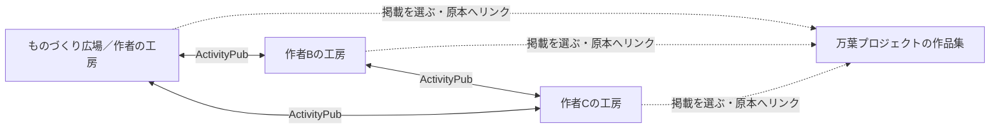

# 創作者それぞれのサイトをつなぐ — 次段階の設計案

2026-11-10。検討用の草案。機能実装や本番設定の変更は行っていません。

## 出発点

ユーザーの選択は「創作者それぞれが自分のサイトを持ち、つながる」。長文、絵、音楽、コードなどを各自の場所に置き、ものづくり広場と万葉プロジェクトを通じて交流・共同制作へ進むことを目指します。

現在のものづくり広場には、一人の管理者、作品の公開・編集機能、一つのActivityPubアカウント、新作のお知らせを配信する機能があります。ユーザーからMastodon・Misskeyで検索・表示できたとの確認を得ています。両サービスで実際の新作通知を受信する確認は、次の公開時に行います。

現時点では、広場側から外部アカウントをフォローして作品を読む機能、返信の表示、共同編集、複数作者のログイン、Symbol連携は未実装です。

## 基本となる構造

| 場所 | 役割 | 決める人 |
| --- | --- | --- |
| 各自の創作サイト（工房） | 作品の原本、紹介、制作記録、公開・修正・取り下げ | その作者 |
| 工房同士のつながり | フォロー、新作の受信、原本へのリンク | 各工房の運営者 |
| ものづくり広場 | 自身の作品公開を続けながら、つながる工房や選んだ作品を紹介 | 広場の運営者と掲載に同意した作者 |
| 万葉プロジェクトの企画ページ | テーマごとの作品集、共同企画、参加者、制作の経緯をまとめる | 企画の参加者 |

万葉プロジェクトの役割は、現在の会話に基づく提案です。詳しい理念・活動に合わせて調整します。広場・企画ページは複数あってよく、特定の一覧サイトを経由しなくても工房同士でフォローできます。

## 各サイトが持つもの

最初の単位は「一人の作者・一つのサイト・一つの連合アカウント」とします。

- 作者紹介、作品一覧、作品の個別URL、制作日誌。
- 長文、画像、音楽、コードなどを置く管理画面。現在は公開済みファイルのURLを指定する方式なので、直接アップロードは別の追加機能として設計します。
- 固有のActivityPubアカウント、署名鍵、フォロー関係。
- 自分の作品と履歴を書き出す機能、および運営者向けの復元手順。
- 他の工房からの新作を読む、管理者用の受信画面。

作品の原本URLと、タイムラインへ配信するお知らせのURLを区別します。お知らせには題名、作者、短い紹介、任意の表紙、原本へのリンクを載せます。長文や音楽を十分に楽しめる場所は各作者の作品ページです。紹介文と表紙は外部サーバーにも保存されうることを、公開操作の説明に含めます。

全員が同じソフトを使う必要はありません。既存のMastodon・Misskeyアカウントともつながり、新しくサイトを作る人には今回のコードを基にした共通テンプレートを提供する方針です。

## 独立したサイトと共通の通信仕様

「各サイトが独立しながら連合する」を、三つの層として設計します。

| 層 | 共通にすること | 各サイトが決めること |
| --- | --- | --- |
| 創作サイト | 必要なら共通のソフト・ひな形を使う | 外観、作品、管理者、保存先、公開・接続の方針 |
| 連合の通信 | ActivityPubによるフォロー、作品のお知らせ、修正・取り下げ | 誰をフォローするか、受信内容をどう扱うか |
| 創作の共通仕様 | 作者・作品・企画・制作上の関係を表す項目と処理の約束 | どの企画に参加し、何を提供・承認するか |

当面は既存のActivityPubとActivityStreamsを基盤にし、創作に必要な情報を段階的に拡張する案です。独自の通信方式を全面的に作る場合には、既存サービスとの橋渡し、発見、認証、再配送、更新・削除の整合性も維持する必要があるため、まず二つの工房の実例から共通仕様を絞ります。

創作の共通仕様の初版候補は、作品の正規URL、作者、題名、種別、紹介、改訂情報、利用条件へのリンク、関連作品・企画へのリンクです。既存の語彙で表せる項目はそれを使い、独自項目には名前空間と版を定めます。共同制作の提案・承認は、その後に状態遷移と権限まで含めて設計します。受信した宣言だけで他人の作品を変更する権限を与えません。

独自項目を解釈しないサービスにも、通常の作品紹介と原本へのリンクが届く形を保ちます。相手が拡張機能を理解・受理したとは、明示的な応答や動作確認なしに扱いません。独自項目の表示や往復保存はサービスごとに確認します。

共通仕様は文書と動作例として公開する方針を提案します。将来、別の人が別のソフトで作った工房も接続できることを目標とし、一つの運営者・中央アカウント・特定のホスティング契約への依存を減らします。万葉の作品集は、そのネットワークの中で企画・編集を担う一つの参加者として位置づけます。

## 次の試作：二つの独立した工房をつなぐ

次の実装範囲は、以下の三つに絞ることを提案します。

1. **新しい工房を作れるテンプレート**：サイト名、作者、URL、連合アドレスを設定できるようにします。現在の固定URL・識別子を整理し、ものづくり広場の既存アカウントと鍵は維持します。新工房には新しいDB・鍵・管理者認証を作り、既存の作品や認証情報を複製しません。
2. **外部の工房をフォローして読む機能**：管理画面で相手のアドレスを入力し、プロフィールを確認してフォロー。申請中・承認済み・解除済みを扱い、届いた新作を表示します。
3. **つながる工房の案内ページ**：運営者が選んだ工房の紹介とリンクを掲載します。フォロー一覧と公開する紹介一覧は別に管理し、掲載方針を明示します。

例：作者Bが自分のサイトで詩を公開すると、Bをフォローしているものづくり広場の受信画面に届きます。気に入った詩を万葉の作品集へ紹介するときは、掲載範囲を確認し、作者名と原本へのリンクを置きます。本文の転載や共同編集への参加は、それぞれ別の同意として扱います。

### 完了条件

- 二つの異なるサイトURLで、それぞれ独立した管理者・DB・署名鍵を持つ。
- 相互にフォローし、一方で公開した新作をもう一方で読める。
- 新作について、Mastodon・Misskeyでも受信を確認する。
- 修正・取り下げ・解除・配送の再試行を確認し、重複配送で同じお知らせが増殖しない。
- 私的な投稿を公開一覧に載せず、下書きと認証情報を外へ送らない。
- 片方が一時停止しても、もう片方は自分の作品を公開・閲覧できる。
- 作品データの書き出しと、新しい環境での復元を確認する。

最初はテスト用の工房を一つ作って確かめ、その後に少人数の作者との試行へ進みます。新しい作者のアカウントや作品を、本人の合意なしに作成・公開しません。

## 実装の方針

Astro・Pages・D1・KV・Queue・Fedifyという現在の構成を基に拡張します。新しい主要データは、外部の作者、フォロー申請と状態、受信作品、公開紹介への選定です。作者・作品の識別には相手サイトの正規URLを使います。

送る処理はFollowとUndoを追加し、受ける処理はAccept・Reject・Create・Update・Deleteを拡張します。ActivityPubは通知や作品情報の配送に用います。受信内容の保存、表示、公開範囲、共同編集の権限はアプリケーション側で実装します。

初期の受信画面では、承認済みのフォロー先から届く公開作品を扱います。外部HTMLをそのまま描画せず、作者・対象作品との対応、配信先、URLを検証して表示します。重複、削除後の遅延配送、フォロー解除後の到着も扱います。公開紹介への掲載は別操作とし、公開範囲の限られた投稿を転用しません。

返信・いいね・共有の受信は次の拡張候補です。返信を作品ページに表示する場合には、承認・非表示・ブロックも一緒に設計します。

## 独立して運営し続けるための条件

- 各作者が自分のサイト・データ・公開判断を管理できること。
- 運営を代行する場合も、所有者、バックアップ、引き渡し方法を明示すること。同じ運営者のCloudflareアカウント内でサイトを分けるだけでは、運営基盤の独立はまだ不十分です。
- 新しい工房の正式URLを、連合公開前に決めること。独自ドメインを使う場合は費用と所有者も決めます。
- 現在の `@hiroba@monozukuri-hiroba-tomo.pages.dev` はそのまま維持。移転は別の計画とし、単なるURL設定変更で済ませません。
- 作品を書き出す機能と、連合アカウントを移転する機能を区別すること。フォロワーやアカウント識別子まで自由に移せるとは、現段階では約束しません。
- 公開紹介や企画から退いても、自分の工房と作品を保持できること。

## 共同制作・DAO・Symbolへのつなぎ方

次の段階では、参加工房を結びつける「企画」を作ります。企画には、目的、参加者、役割、関連作品、提案、決定、公開する成果物の版を記録します。最初は企画の調整役が管理する一つのページを正本とし、参加者は提案と承認を行います。各工房からそのページへリンクできます。

文章の同時編集や制作ファイルの同期には別の仕組みが必要です。小さく始めるなら、版を添えた成果物を提出し、レビューして採用する方法が扱いやすいと考えます。フォロー、共同制作への参加、編集権限、運営上の決定権はそれぞれ別にします。

DAOの設計は、参加・退出、役割、意思決定、作者表記、成果物の利用条件、費用の扱いを先に定めます。初期の意思決定は参加者ごとの合意を基本案とし、XYMの保有量を参加・閲覧の条件にはしない方針を提案します。

Symbolは、共同資金を複数人で承認するマルチシグや、合意した記録のハッシュを残す用途が候補です。導入時はテストネットで手順を確認し、署名者・鍵の管理・手数料・変更方法を具体化します。ハッシュ記録だけで作者の真正性や合意の中身が自動的に確認できるわけではないため、元文書、版、誰が何に同意したかを併せて管理します。マルチシグは共同資金の操作を制御する仕組みで、企画の議論や採決の画面は別途必要です。

作品本文や日常の投稿は各工房の保存基盤に置き、Symbolとの連携は、用途が定まった企画が選んで利用する構成にします。

## 実装前に詰めること

基本方針は決定済み：各作者が自分のサイトを持つ。

次に具体化するのは、最初の参加者の人数、サイトの開設・運営を誰が担うか、工房のURL、受信画面の見せ方です。暫定案は「少人数で試行、運営支援あり、受信は管理者のみ、公開紹介は手動選定」。費用の数値は構成と利用量が決まってから確認します。

## 参照

- [ActivityPub仕様](https://www.w3.org/TR/activitypub/)：サーバー間の通知・配送とアクティビティ。
- [ActivityStreamsの拡張](https://www.w3.org/TR/activitystreams-core/#extensibility)：共通のデータ形式に独自の語彙を加える仕組み。
- [FedifyのInbox listeners](https://fedify.dev/manual/inbox)：受信処理をアプリケーションに追加する方法。
- [SymbolのMultisig Account](https://docs.symbol.dev/concepts/multisig-account.html)：複数署名による操作の承認。
