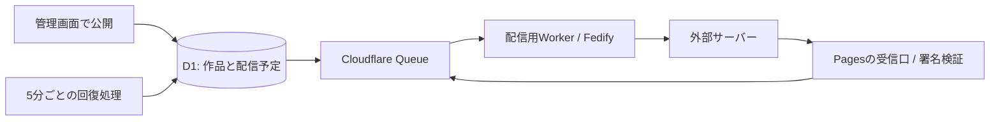

# 外部からフォローできるものづくり広場

第一段階は、広場を一つのアカウントとしてフォローし、これから公開する作品のお知らせを受け取れるようにすることです。

- アドレス: `@hiroba@monozukuri-hiroba-tomo.pages.dev`
- 案内: `/follow/`
- Actor: `/ap/actors/hiroba`
- WebFinger: `/.well-known/webfinger?resource=acct:hiroba@monozukuri-hiroba-tomo.pages.dev`
- 作品のお知らせ: `/ap/notes/{publication-id}`

Mastodon等の検索欄でアドレスを検索し、プロフィールからフォローします。見出し・説明・表紙画像（設定した場合）と作品のURLを配信します。長い本文、動く絵画、音楽などは作品ページで読んだり再生したりできます。外部サービスごとの表示は異なります。

## 公開と配信

管理画面で新作を公開すると、D1トリガーが公開状態と配信予定を同じトランザクションで記録します。既存の39作品は導入時に一斉配信しません。導入前から公開中の作品を編集しても新規通知は作りません。一度取り下げたものを改めて公開すると新規通知になります。

公開中の新作の編集は `Update`、下書きへの変更・ごみ箱への移動は `Delete` を送ります。再公開には新しいNote IDを使います。取り下げたNoteのURLは本文を含まない `410 Tombstone` を返します。配送直前にも現在の公開状態を確認します。既に他サーバーが保存・転載した内容の完全な消去までは保証できません。

構成は以下です。



`global_fetch_strictly_public` をPagesと配信用Workerで有効にし、同じCloudflareアカウントにある別の創作サイトへも公開URLを経由して接続します。

PagesはQueueの送信側です。別Workerが受信側と回復処理を担当します。KVはFedifyのキャッシュと重複処理の抑制に使用し、アカウントの署名鍵とフォロワーはD1に保存します。署名鍵を毎回生成し直してはいけません。公開プレビューからのフォロー受付と管理APIへの書き込みは拒否します。

配送失敗は待ち時間を延ばして最大8回試します。それでも失敗したジョブをD1の `ap_failures` に保持します。管理画面にはフォロワー数、配信準備待ち件数、失敗件数を表示し、失敗分は「届かなかった通知を再送する」で20件ずつ再投入できます。統計・再送には既存の管理者認証が必要です。再試行でもActivity IDは変わりません。

## 初回の公開手順

Node.js 24を使います。現在のPages/D1権限に加え、Worker・KV・Queueの作成権限が必要です。有料プランへの変更は行いません。

```sh
npx wrangler login --device --browser=false --scopes account:read user:read pages:write d1:write workers:write workers_scripts:write workers_kv:write queues:write
npx wrangler kv namespace create FEDERATION_KV --config wrangler.federation.jsonc
npx wrangler queues create monozukuri-hiroba-federation
```

作成されたKV IDを `wrangler.jsonc` と `wrangler.federation.jsonc` の両方に設定します。ゼロの仮IDではデプロイ前チェックが停止します。

```sh
npx wrangler d1 migrations apply monozukuri-hiroba-content --remote
node scripts/prepare-federation-key.mjs
npx wrangler d1 execute monozukuri-hiroba-content --remote --file .admin-private/federation-key.sql
npm run deploy
```

鍵のSQLファイルは秘密情報です。Git管理外の権限600で生成され、内容はログに表示しません。安全なバックアップを取った後、端末の不要なコピーを削除してください。`INSERT OR IGNORE` によって既存の署名鍵を上書きしません。通常の作品データ書き出しには署名鍵・フォロワー・配送ジョブを含めません。

`npm run deploy` は型検査・ビルド・CMS/Fedifyテスト・workerdでの模擬配送テストを行い、配信用Worker、既存のPagesの順で更新します。DBの初期データを再投入しません。導入後はこのコマンドで更新できます。

## 検証

```sh
npm run check
npm run build
npm run test:cms
npm run test:federation
npm run test:federation-runtime
```

単体テストでは署名の拒否/受理、Follow/Undoの順序逆転、公開/修正/取り下げ/再公開、重複排除、キュー障害、下書きの非公開を検査します。workerdテストはD1・KV・Queueを接続し、署名付きFollow→Accept→新作Createの署名検証→取り下げまでを実行します。相手サーバーとDNSは模擬し、実際のアカウントには送信しません。

公開後はWebFingerとActorを外部HTTPで確認し、実際のMastodon等からのフォローと次の作品の受信を確認します。ローカルの模擬テストだけで実サーバー間の確認済みとは扱いません。

依存ライブラリの `@opentelemetry/sdk-metrics` は、Fedifyが固定する版の推移依存に脆弱性があるため、互換性のある2.xの修正版2.12.1にoverrideしています。

参考: [FedifyのCloudflare対応](https://fedify.dev/manual/deploy)、[PagesのQueueバインディング](https://developers.cloudflare.com/pages/functions/bindings/#queue-producers)。

## 本番での確認（2026-11-10）

- 既存39作品を保持して導入。過去作品の配信イベントは作成していません。
- WebFinger・Actor・フォロー案内・既存ページ・RSSの応答を確認。未署名Followは401、プレビューのActorは404。
- 別の公開URLに設けた検証用Actorから署名付きFollowを送り、本番Queueを経由して返ったAcceptの署名を検証。Undoによる解除も確認しました。
- 新作のCreate・修正・取り下げは、workerd/D1/KV/Queueを接続した模擬環境で検証。実在のMastodonアカウントの画面上での表示確認は別途行います。
- 配信用Worker版: `ae3c375c-6c30-43ea-9911-a69c0d8adf9d`。5分ごとの回復処理とQueueの受信処理を公開済み。
- Workers初回設定として `monozukuri-hiroba-tomo.workers.dev` を登録。作品サイトの正式URLは従来のPages URLです。
